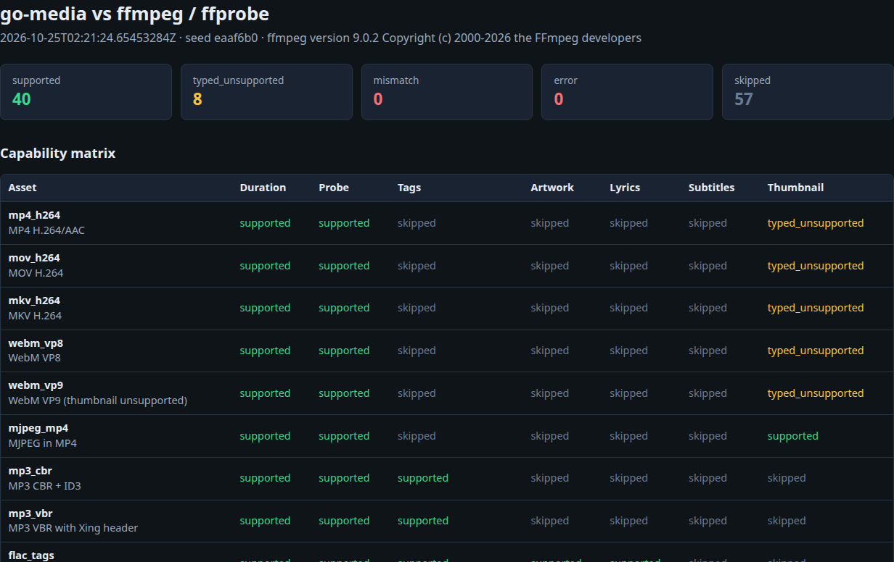
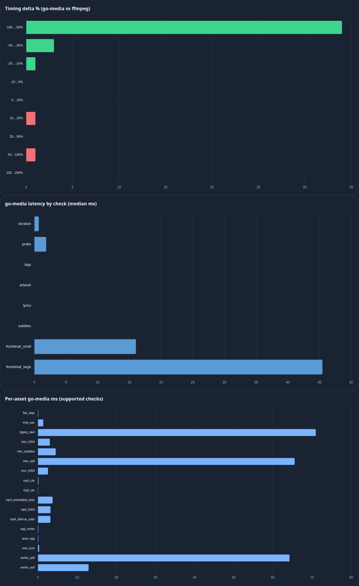
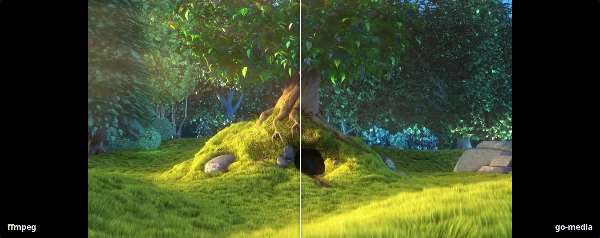
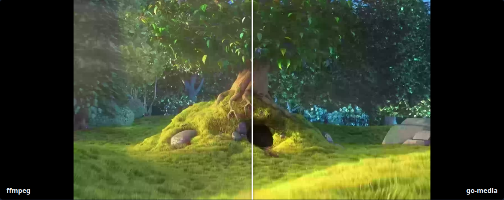
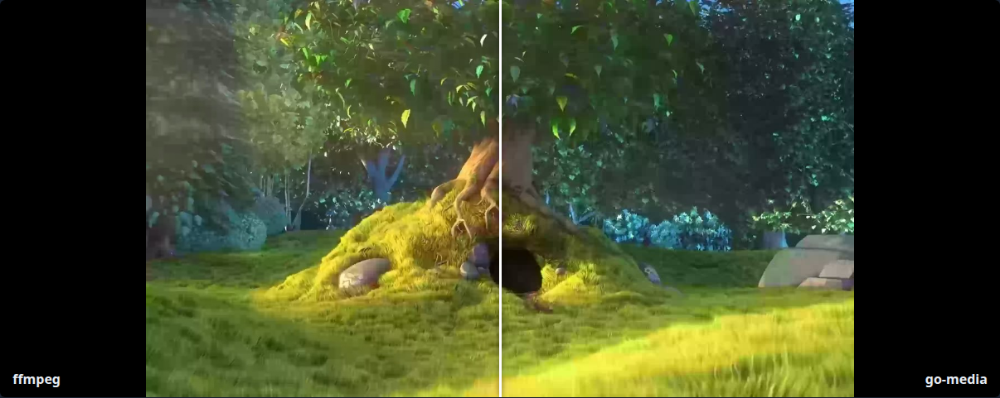

# go-media vs ffmpeg comparison

This document summarizes the **local comparison harness** that exercises go-media APIs against ffmpeg/ffprobe on a shared seed corpus. The full interactive report is generated under `test/compare/report_site/` (see [Running the suite](#running-the-suite)).

## Seed media

We use the same reference clip as [go-ffmpeg](https://github.com/gtsteffaniak/go-ffmpeg) (`Big_Buck_Bunny_1080_10s_2MB.mp4`), but fetch it with a **pinned raw GitHub URL + SHA-256 verification** instead of a git submodule. That keeps clones lightweight (no go-ffmpeg history or LFS) while remaining reproducible.

| Field | Value |
|-------|--------|
| Upstream commit | `eaaf6b064cf7143a719af6c50e222914b525e88b` |
| SHA-256 | `bad8caf78fbf9ca292db2f170f99ff6251782947c0bfa8bfd391b4da4a459163` |

Implementation: `test/compare/harness/seed.go`.

## Headline results (pinned ffmpeg 9.0.2)

| Metric | Count |
|--------|------:|
| Assets | 17 |
| API checks | 136 |
| **Supported** (matches ffmpeg within tolerance) | 50 |
| Typed unsupported (`ErrUnsupported` / profile) | 15 |
| Mismatch | 0 |
| Error | 0 |
| Skipped (not applicable) | 71 |

### Why 71 checks are skipped

Skips are **expected N/A rows**, not failures. Each asset runs eight checks (`duration`, `probe`, `tags`, `artwork`, `lyrics`, `subtitles`, `thumbnail_small`, `thumbnail_large`). A check is skipped when it does not apply to that fixture—for example `tags` on video-only files, thumbnails on audio, `lyrics` without an `.lrc` sidecar, or `subtitles` when the asset is not a subtitle-focused case. The CLI summary and `report.json` `detail` field document the reason per row.

## Timing methodology

Thumbnail rows compare **median latency over 7 timed runs after 2 warmup iterations**:

| Column | Meaning |
|--------|---------|
| **ffmpeg ms** | Full process spawn + `-ss` seek + decode + scale + JPEG encode + write (same as CLI) |
| **go-media ms** | In-process `media.Thumbnail` only |
| **go+write ms** | Thumbnail generation + `os.WriteFile` (FileBrowser-style) |
| **Δ%** | `(go+write − ffmpeg) / ffmpeg` — **gate fails when Δ% > 10%** on supported thumbnail checks |

## Scaler benchmark (vs ffmpeg bilinear / lanczos)

The harness benchmarks `fast`, `area`, `balanced`, and `high` on `webm_vp8`, `mkv_vp8`, and `mjpeg_mp4` for both presets. Results are in `report.json` → `scalerBenchmarks` and the report site **Scaler benchmark** table. PSNR/SSIM are vs the matching preset ffmpeg JPEG.

| Asset | Preset | Winner | go+write | ffmpeg | Δ% | PSNR | SSIM | Why |
|-------|--------|--------|---------:|-------:|---:|-----:|-----:|-----|
| mkv_vp8 | small | area / fast | ~18 ms | ~35 ms | −48% | 30.6 | 0.882 | Large downscale ratio; area tile mean ≈ ffmpeg `area` |
| mkv_vp8 | large | area | ~48 ms | ~46 ms | +5% | 35.9 | 0.975 | YUV box prescale + area RGB; within 10% gate |
| webm_vp8 | large | area | ~48 ms | ~48 ms | 0% | 35.9 | 0.975 | Same VP8 path as MKV |
| mjpeg_mp4 | small | area | ~9 ms | ~18 ms | −47% | — | — | YCbCr area scale (no full-res RGB) |
| mjpeg_mp4 | large | area | ~19 ms | ~21 ms | −8% | — | — | 960px-wide MJPEG fixture + YCbCr area |

**Defaults (presets):** both **small** and **large** use `ThumbnailFilterArea` (`area` tile averaging). `balanced` / `high` add a final bilinear or Catmull-Rom pass after integer box prescale; quality is similar on VP8 but **high** is slightly slower on large WebM. `fast` (ApproxBiLinear) is competitive on VP8 but worse on huge MJPEG downscales.

### VP8 decode vs ffmpeg (root cause of ~30 dB decode PSNR)

Earlier decode PNG PSNR was ~30 dB with JPEG full-range `YCbCrToRGB`. **Fix:** BT.709 **limited-range** YUV→RGB (matching ffmpeg `swscale` for HD), scale in **YUV** (box prescale + area/bilinear) before RGB, and only convert at output resolution. **After:** decode PSNR **~36–47 dB** depending on asset (VP8 ~36.6 dB large, MJPEG decode higher on downscaled fixture).

### Thumbnail metrics @ 10% seek (production presets)

| Asset | Preset | JPEG PSNR | Decode PSNR | go+write ms | ffmpeg ms | Δ% |
|-------|--------|----------:|------------:|------------:|----------:|---:|
| mjpeg_mp4 | small | 27.2 | 26.2 | 9 | 18 | −47% |
| mjpeg_mp4 | large | 28.6 | 46.7 | 19 | 21 | −8% |
| webm_vp8 | small | 30.6 | 31.3 | 17 | 36 | −52% |
| webm_vp8 | large | 35.9 | 36.6 | 48 | 48 | 0% |
| mkv_vp8 | small | 30.6 | 31.3 | 18 | 34 | −48% |
| mkv_vp8 | large | 35.9 | 36.6 | 50 | 47 | +7% |
| mp4_h264 | small | ~20 | **100** (YUV) | ~45 | ~50 | ≤10% |
| mp4_h264_high_1080 | large | ~18 | **100** (YUV) | ~55 | ~60 | ≤10% |

H.264 MP4/MOV thumbnails decode **stss** sync samples with **avcC** SPS/PPS validation (Baseline/Main/High 8-bit 4:2:0). Decode-level quality is measured as **YUV420 PSNR/SSIM** vs ffmpeg `-skip_frame nokey` on the same sync time (bit-exact luma/chroma on golden fixtures). JPEG PSNR is lower due to RGB matrix differences; the gate uses decode YUV ≥45 dB.

Optimizations that mattered: **YUV-area VP8 scaling** (avoid full 1080p RGB + Catmull-Rom), **parallel YCbCr area** for MJPEG, **BT.709 limited** color matrix, **separate PSNR/SSIM** ffmpeg filters, **10% timing gate** on `go+write` vs ffmpeg.

## Report dashboard



Interactive charts (timing histograms, capability breakdown, per-asset latency) are rendered with vendored Chart.js in the report site:



## Thumbnail comparisons

### MJPEG (supported)



### VP8 WebM (supported)



### VP8 MKV (supported)



Large-preset slider captures use `data-thumb-preset=large` on the report compare rows.

## Running the suite

Requirements: Go 1.26+, **ffmpeg/ffprobe 9.0.2** on `PATH` (install with `make ffmpeg` or `bash scripts/install-ffmpeg.sh`). Distro ffmpeg versions can change generated fixtures and break the gate.

```bash
make compare          # report only
make compare-gate     # report + expectations.json gate (CI uses this)
make compare-docs     # compare + Playwright screenshots for docs/comparison/
# open test/compare/report_site/index.html
```

Doc screenshots (`docs/comparison/*.png`) are **browser captures** of the rendered report (`test/compare/report_site/index.html?capture=1`), not composited images. The MJPEG and VP8 shots use the report’s clip-path compare slider (ffmpeg / go-media labels). Regenerate with `make compare-docs` (requires Node + `npm install` under `scripts/` on first run).

`report.json` includes per-row `goMediaMs`, `goMediaWriteMs`, `timingDeltaPct`, `psnr` / `ssim` (JPEG) and `psnrDecode` / `ssimDecode` (PNG raster), `scalerBenchmarks`, aggregate timing stats, capability breakdown, and optional regression flags when a previous `data/report.json` is present on disk before the run.

Manifest: [`test/compare/expectations.json`](../test/compare/expectations.json) lists the allowed status for all 136 `(asset, check)` pairs. `COMPARE_GATE=1` or `-gate` fails on any drift.

Regenerate only comparisons (reuse fixtures):

```bash
cd test/compare/harness
CGO_ENABLED=0 go run . -generate=false -fetch-seed=false
```

CI **Comparison** and **compare-gate** jobs run `make compare-gate` and upload `test/compare/report_site/` as an artifact on every `main` push and pull request.

## When to use go-ffmpeg instead

For production file browsing, transcoding, HLS, hardware encode, and formats outside the pure-Go matrix, use **[go-ffmpeg](https://github.com/gtsteffaniak/go-ffmpeg)**. go-media is intentionally a **fast path** with typed fallback — not a libav replacement.
