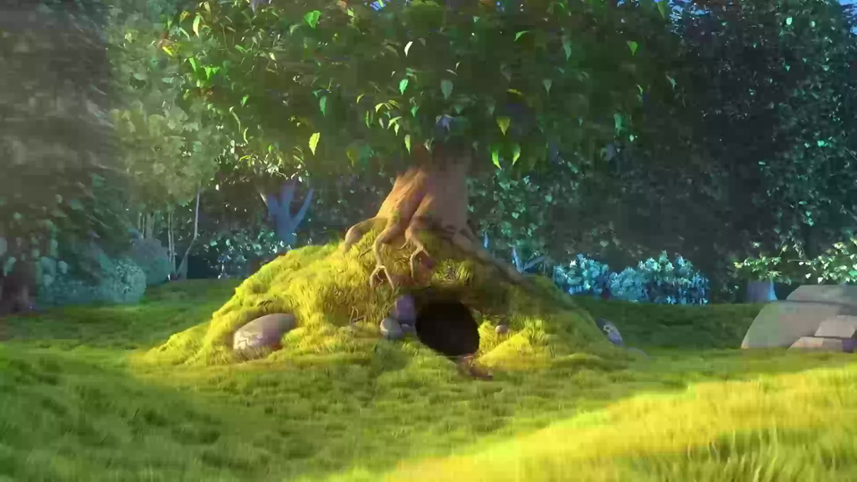

# go-media vs ffmpeg comparison

This document summarizes the **local comparison harness** that exercises go-media APIs against ffmpeg/ffprobe on a shared seed corpus. The full interactive report is generated under `test/compare/report_site/` (see [Running the suite](#running-the-suite)).

## Seed media

We use the same reference clip as [go-ffmpeg](https://github.com/gtsteffaniak/go-ffmpeg) (`Big_Buck_Bunny_1080_10s_2MB.mp4`), but fetch it with a **pinned raw GitHub URL + SHA-256 verification** instead of a git submodule. That keeps clones lightweight (no go-ffmpeg history or LFS) while remaining reproducible.

| Field | Value |
|-------|--------|
| Upstream commit | `eaaf6b064cf7143a719af6c50e222914b525e88b` |
| SHA-256 | `bad8caf78fbf9ca292db2f170f99ff6251782947c0bfa8bfd391b4da4a459163` |

Implementation: `test/compare/harness/seed.go`.

## Headline results (latest local run)

| Metric | Count |
|--------|------:|
| Assets | 15 |
| API checks | 105 |
| **Supported** (matches ffmpeg within tolerance) | 31 |
| Typed unsupported (`ErrUnsupported` / profile) | 12 |
| Mismatch | 9 |
| Error | 1 |
| Skipped (not applicable) | 52 |

**Takeaways**

- **Duration + probe** are strong on MP4/MOV/MKV/WebM, WAV/FLAC/OGG/MP3/M4A fixtures derived from the seed or synthetic audio.
- **Tags + artwork** align for ID3, Vorbis, and MP4 `ilst` on the generated audio matrix; FLAC embedded pictures are detected.
- **Subtitles**: sidecar SRT/VTT/ASS convert to WebVTT; MKV embedded SRT extracts. MP4 embedded subtitle listing remains typed-unsupported (expected).
- **Thumbnails**: MJPEG-in-MP4 previews match ffmpeg closely. H.264 in MP4/MOV/MKV and VP8 WebM often return `ErrUnsupportedProfile` (H.264 decoder stub; VP8 golden/alt-ref frames) — ffmpeg is still required for those previews.

## Report dashboard


## Thumbnail comparisons

### MJPEG (supported)


### VP8 WebM (ffmpeg reference; go-media typed-unsupported on golden frames)



## Running the suite

Requirements: Go 1.26+, ffmpeg/ffprobe on `PATH` (CI installs a **pinned static build** via `scripts/install-ffmpeg.sh`).

```bash
bash scripts/run-comparison.sh
# open test/compare/report_site/index.html
```

Regenerate only fixtures or only comparisons:

```bash
cd test/compare/harness
CGO_ENABLED=0 go run . -generate=false   # reuse .assets/
```

CI workflow **Comparison** uploads `test/compare/report_site/` as an artifact on every `main` push and pull request.

## When to use go-ffmpeg instead

For production file browsing, transcoding, HLS, hardware encode, and formats outside the pure-Go matrix, use **[go-ffmpeg](https://github.com/gtsteffaniak/go-ffmpeg)**. go-media is intentionally a **fast path** with typed fallback — not a libav replacement.
